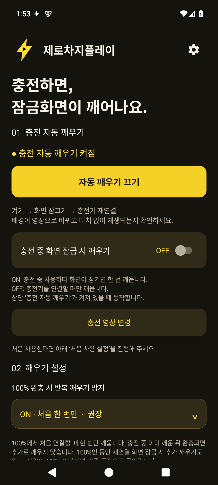

# 제로차지플레이 · Zero ChargePlay

**충전하면 잠금화면이 깨어나고, 설정한 영상 배경이 재생됩니다.**

### [⬇ 눌러서 앱 설치 파일 받기 (.apk)](https://github.com/ZERO-hms/zero-chargeplay/releases/download/v1.0.2/zero-chargeplay-1.0.2.apk)

**v1.0.2 정식 버전 · Android 12 이상 · 삼성 갤럭시용**  
파일: `zero-chargeplay-1.0.2.apk` · GitHub 로그인 없이 다운로드

[이번 버전 변경사항](https://github.com/ZERO-hms/zero-chargeplay/releases/tag/v1.0.2) · [설치·보안 안내](#설치-방법) · [검증 안내](VALIDATION.md)

## v1.0.2에서 달라진 점

- **100% 완충 시 반복 깨우기 방지** 선택 옵션 추가 · 기본 ON
- 처음 한 번 깨운 뒤에는 100% 상태의 반복 재연결·잠금 전환 깨우기를 막고, 잔량이 100% 미만이면 기존 동작으로 복귀
- 충전 중 폰이 잠길 때 깨우기를 상단의 별도 ON/OFF 스위치로 조절
- 기존 지연 시간·테마·안내 진행 및 자동 깨우기 설정 유지

## 만든 이유

삼성 루틴에서 충전할 때 동영상 잠금화면으로 바뀌도록 설정해도, AOD 상태에서는 화면을 터치하기 전까지 영상이 재생되지 않는 경우가 있습니다. 제로차지플레이는 **충전을 감지해 기본 잠금화면을 한 번 깨워 주는 앱**입니다. Automate의 별도 흐름을 만들지 않아도 되며, 잠금화면의 시계·위젯과 보안 잠금은 그대로 사용합니다.

**영상 배경 선택은 삼성 루틴, 화면 깨우기는 제로차지플레이, 긴 화면 유지 시간은 LockStar가 담당합니다.** 처음에는 앱의 따라하기 안내로 필요한 설정을 직접 완료해야 합니다. AOD 자체는 정지 화면을 표시하며, 화면을 깨운 뒤 잠금화면에서 영상이 재생됩니다.

## 주요 기능

- **충전 자동 깨우기** — 유선·무선 충전 연결을 감지해 기본 잠금화면을 깨웁니다. 사용 중이면 불필요한 깨우기를 생략합니다.
- **충전 중 다시 잠글 때 한 번 깨우기** — 상단의 별도 ON/OFF 스위치로 조절합니다. 휴대폰 사용 후 잠금 버튼이나 자동 잠금으로 전환될 때 동작합니다. 잠금화면이 다시 꺼질 때는 반복하지 않습니다.
- **지연 시간 조절** — 충전 연결은 0·1·2·3초(권장 1초), 잠금 전환은 0.5·1·2·3초(권장 0.5초). 실제 잠금화면 준비 시간은 기기 설정에 따라 추가될 수 있습니다.
- **설정 따라하기** — 루틴·AOD·LockStar 및 충전 영상 교체를 단계별로 안내합니다. 안내창은 이동·접기가 가능하며, AOD 설정은 작은 화면(PiP)으로 안내합니다.
- **세 가지 테마** — 라이트·다크·시스템 설정에 맞춤을 제공합니다.
- **앱 업데이트** — 상단 톱니바퀴에서 버전 확인, 변경사항, APK 다운로드, 설치 안내를 볼 수 있습니다. 약 6시간마다 새 정식 버전을 확인하고 한 버전당 한 번 알립니다. 절전·네트워크에 따라 늦어질 수 있으며 자동 확인을 꺼도 수동 확인은 가능합니다.
- **기존 설정 유지** — 앱을 삭제하지 않고 업데이트하면 지연 시간·테마·안내 진행 상태가 이어집니다. 켜둔 자동 깨우기는 재개하고, 꺼둔 상태는 유지합니다. 기기가 백그라운드 재개를 제한하면 앱을 한 번 열어 주세요.

초기 베타의 별도 영상 플레이어·랜덤 재생·앱 내 영상 편집 기능은 정식 버전에 포함되지 않습니다. 현재 버전은 삼성 기본 잠금화면을 유지하는 방식입니다.

## 완충 시 반복 재생 방지

앱의 **02 깨우기 설정 → 100% 완충 시 반복 깨우기 방지 → ON · 처음 한 번만**을 선택하세요. 업데이트 후 기본값은 ON입니다.

- **100%에서 처음 연결**하면 한 번 깨웁니다. 충전 중 이미 재생한 뒤 100%가 된 경우에는 추가로 깨우지 않습니다.
- 이후 100%인 동안의 충전 재연결과 폰 잠금 시 추가 깨우기를 막습니다. 잠금 전환 스위치가 ON이어도 완충 제한이 우선합니다.
- **잔량이 100% 미만으로 확인되면** 제한을 풀고, 다음 충전 연결·잠금 전환부터 기존 설정대로 동작합니다. 잔량이 내려간 순간에 영상을 강제로 재생하지는 않습니다.
- **OFF · 기존 방식**을 선택하면 완충 제한 없이 기존대로 동작합니다. 켜짐/꺼짐을 바꾸거나 앱이 재시작돼도 100%에서 이미 깨운 기록을 기억합니다.
- 짧은 충전 신호 끊김과 실제로 충전기에서 내려놓는 동작은 확실히 구분하기 어려워, 100%인 동안에는 다시 올려놓아도 추가로 깨우지 않습니다.

이 옵션은 **제로차지플레이가 보내는 깨우기 신호만 제한**합니다. 삼성 루틴·휴대폰·충전기가 스스로 화면을 켜거나 배경을 바꾸는 동작까지 차단하지는 않습니다.

## 처음 사용하는 방법

1. APK를 설치하고 앱을 엽니다. 자동 깨우기에 필요한 알림을 허용합니다.
2. **루틴 설정 따라하기**에서 충전 중 조건과 잠금화면 영상 배경을 설정합니다. 충전 해제 시 원래 배경으로 복원하는 동작도 확인합니다.
3. 필요하면 **AOD 설정 따라하기**로 AOD 및 잠금화면 배경 표시를 설정합니다. 해당 옵션은 지원 기기에만 있습니다.
4. 영상이 끝나기 전에 화면이 꺼진다면 **LockStar 설정 따라하기**로 잠금화면 자동 꺼짐 시간을 조절합니다.
5. 상단의 **충전 자동 깨우기 켜기**를 누른 뒤 화면을 잠그고 충전기를 다시 연결해 확인합니다.

영상 교체는 **충전 영상 변경**을 누르고 안내에 따라 삼성 루틴의 잠금화면 배경을 변경하세요. 앱이 루틴의 영상 선택을 자동으로 대신하지는 않습니다.

## 설치 방법

기존 사용자는 **앱을 삭제하거나 데이터를 지우지 말고 APK를 열어 덮어 설치**하세요. 삭제·데이터 초기화 후에는 기존 앱 설정이 유지되지 않습니다. 설치 안내는 앱 상단 톱니바퀴 → **설치 · 보안 설정 안내**에서도 볼 수 있습니다.

### 출처를 알 수 없는 앱 설치

설정에서 **출처를 알 수 없는 앱 설치**를 검색 → APK를 연 **브라우저 또는 내 파일** 선택 → **이 출처 허용**을 켭니다. 제로차지플레이에 주는 권한이 아닙니다. 설치 후 같은 메뉴에서 다시 끌 수 있습니다. [삼성 공식 안내](https://www.samsung.com/us/support/troubleshoot/TSG10001914/)

### 삼성 보안 위험 자동 차단

이 기능이 설치를 막는 경우, 공식 배포처의 파일임을 확인한 뒤 **설정 → 보안 및 개인정보 보호 → 보안 위험 자동 차단**을 일시 해제할 수 있습니다. **설치 후 다시 활성화하세요.** 기종·Android·One UI에 따라 메뉴가 다릅니다. [삼성 공식 안내](https://www.samsung.com/sg/support/mobile-devices/protect-your-galaxy-device-with-the-new-auto-blocker-feature/)

### 앱 기능 권한과 Play 프로텍트

설치 허용과 앱 기능 권한은 별개입니다. 이 앱은 알림·다른 앱 위에 표시·화면 속 화면을 기능별로 안내하며, 접근성·사용정보 접근 권한을 요구하지 않습니다. ‘제한된 설정 허용’을 일괄 적용할 필요가 없습니다.

Play 프로텍트의 **검사 요청**과 **유해 앱·기기 보호 차단**은 다릅니다. 검사를 진행하고 공식 파일·버전을 확인하세요. 차단이 계속되면 개발자에게 알려 오탐 검토를 요청할 수 있습니다. 모든 경고를 무시하거나 보호 기능 전체를 계속 끄지 마세요. 특정 설정 해제로 모든 차단이 해결되지는 않습니다. 회사·학교 관리 기기의 정책 제한은 관리자에게 문의하세요. [Google 공식 안내](https://support.google.com/android/answer/2812853)

## 지원 환경·권한·동작 범위

- Android 12 이상 삼성 갤럭시. 삼성 모드 및 루틴의 동영상 잠금화면 변경 기능이 필요합니다. 기종·One UI·메인/커버 화면에 따라 제공 메뉴가 다릅니다.
- **알림**: 자동 깨우기 실행 상태·중지 버튼 및 새 버전 안내. 실행 중 감지 알림이 표시되며 앱 아이콘에 알림 숫자를 추가하지 않습니다.
- **다른 앱 위에 표시 / 화면 속 화면**: 설정을 따라가는 안내창에 사용합니다. 화면 위에 영상 플레이어를 덮는 기능이 아닙니다.
- **화면 깨우기·백그라운드 실행**: 충전·잠금 전환 감지와 짧은 깨우기에 사용합니다. 잠금 해제나 보안 우회는 하지 않습니다.
- **인터넷·네트워크 상태 / 재부팅 수신**: 공개 GitHub 버전 정보 확인과 업데이트 확인 예약 복원에 사용합니다.
- 기본 잠금화면 유지 시간은 LockStar·휴대폰 설정에 따릅니다. 이 앱은 화면을 무제한 켜두지 않습니다.
- 재부팅·강제 종료 후에는 앱을 열어 자동 깨우기를 다시 켜주세요. 충전 감지가 자주 중단되면 앱 정보의 배터리 설정을 확인하세요.
- 일반 Android 기기 전체나 모든 갤럭시의 AOD·커버 화면 동작을 보장하지 않습니다.

## 개인정보·배포

영상은 삼성 설정에서 선택하며, 앱 설정은 기기에 저장합니다. 업데이트 확인 시 GitHub에 공개 버전 정보를 요청하므로 IP 등 일반 접속 정보가 전달되지만, 영상·충전 상태·앱 설정을 업로드하지 않습니다. APK 다운로드는 브라우저에서, 설치 승인은 Android 화면에서 직접 진행합니다.

이 저장소는 **설치 파일·사용 안내·앱 이미지 배포 전용**입니다. 앱 소스는 공개하지 않습니다. GitHub가 자동으로 만드는 `Source code` ZIP/TAR에는 공개 안내 자료만 들어 있으며, 앱 설치에는 반드시 `.apk`를 받으세요.

문제가 있으면 [Issues](https://github.com/ZERO-hms/zero-chargeplay/issues)에 기기 모델, Android/One UI 버전, 재현 순서를 남겨 주세요.
